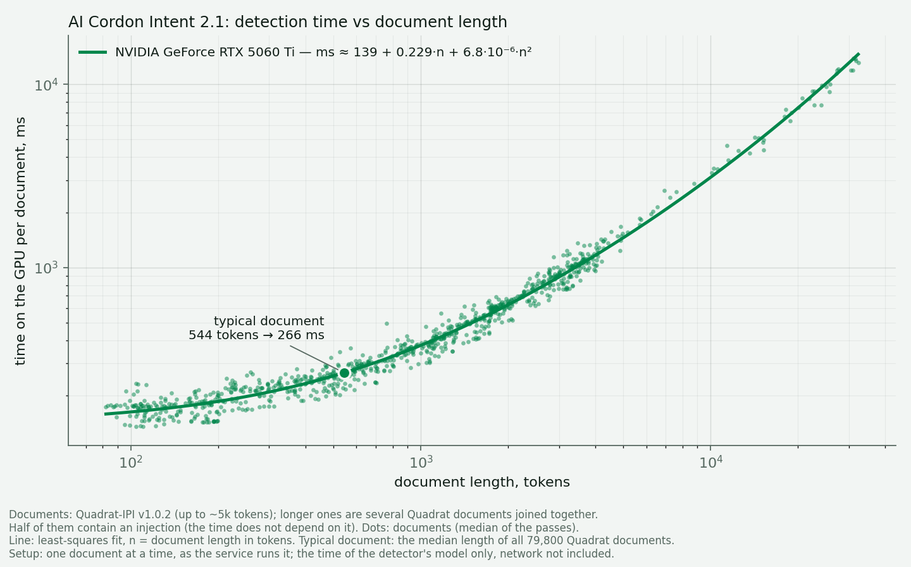

# Latency — how long the detector takes per document

> **AI Cordon Intent [2.1](results/intent-2.1.1/) checks a typical document in 266 ms on an RTX 5060 Ti; a 5,000-token document takes about 1.4 s.**

How long the model of an AI Cordon detector takes to read one document, against the document's
length, on a given GPU. Network time to the API is not in these numbers.

## Result: AI Cordon Intent 2.1 on an NVIDIA RTX 5060 Ti (16 GB)

**ms ≈ 139 + 0.229·n + 6.8·10⁻⁶·n²** for a document of n tokens (95% intervals: 136.5–141.9;
0.224–0.233; 6.3–7.5·10⁻⁶).

| document | tokens | time |
|---|---:|---:|
| typical (median length of Quadrat-IPI) | 544 | 266 ms |
| | 1,000 | ~375 ms |
| | 5,000 | ~1.4 s |
| | 32,000 | ~13–14 s |

Whether the document holds an injection makes no difference: half of the documents do, and they lie
on the same curve. The fit holds within a few percent of the measured times from 100 to 32,000
tokens. Peak GPU memory at 32,000 tokens: 12.2 GB.

Setup: one document at a time, as the service runs it; the time of the detector's model only,
network not included.

## The test

- **Documents.** 900 from Quadrat-IPI v1.0.2 (sha256-checked), 100 in each of nine length bins from
  0–500 to 15,000–21,000 characters, half with an injection; plus 48 longer ones, 5,000 to 32,000
  tokens, each several Quadrat documents joined together, half with an injection inserted. Built by
  `build_docs.py` with a fixed seed; the texts are not redistributed here.
- **Timing.** Each document alone, the GPU synchronized before and after; a warm-up pass over a
  spread of lengths first, so first-time kernel compilation stays out. Three passes over the set,
  each in its own shuffled order; the time of a document is the median of its passes.
- **Fit.** a + b·n + c·n², least squares on log time, so every document counts by its relative
  error; intervals by bootstrap over documents.

## Files

- `results/intent-2.1.1/rtx5060ti_r{1,2,3}.jsonl` — every document of every pass: id, length in
  characters and tokens, carrier, label, time, peak memory.
- `bench.py` — the timing harness; it runs next to a local build of the detector, which is not public.
- `build_docs.py` — the document set from Quadrat-IPI; `docs_meta.json` — its median length.
- `plot.py` — the figure and the fit from the result files.
